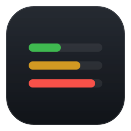
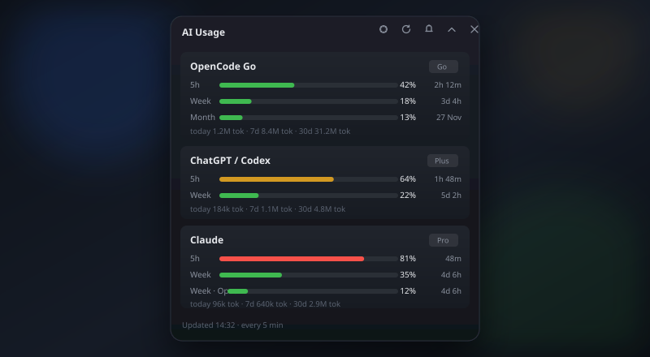

<p align="center">
  
</p>

<h1 align="center">AI Usage Widget</h1>

<p align="center">
  A small Windows tray widget that shows how much of your AI subscription is left,
  without opening a browser or a dashboard.
</p>

<p align="center">
  
  
  
  
  <a href="https://github.com/JorgeZavalaO/ai-usage-widget/actions/workflows/ci.yml"></a>
</p>

<p align="center">
  
</p>

<p align="center"><sub>Preview with illustrative data. No account details are shown.</sub></p>

## What it does

AI Usage Widget lives in the Windows tray and keeps a compact card with the usage
windows that matter:

| Provider | Quota windows |
|---|---|
| **OpenCode Go** | 5h rolling, weekly, monthly (billing-cycle reset) |
| **ChatGPT / Codex** | 5h, weekly |
| **Claude** | 5h, weekly, plus Opus/Sonnet windows when the plan exposes them |

Each card also shows local token consumption for today, the last 7 local dates,
and the last 30 local dates. Cost in USD is shown where the source provides it
(today that is OpenCode only).

A separate **Usage statistics** window (chart button in the header) plots the
last 30 local days as stacked bars per provider: input + output tokens, or cost.
A legend item can be clicked to hide that provider so a smaller series stays
readable. Cached input is excluded from the token chart because it dominates the
raw total (in agentic sessions it can exceed 95% of the sum). Methodology, data
availability, and cost rules are in
[`docs/statistics-window.md`](docs/statistics-window.md).

The widget is deliberately small: WPF, one executable, no Electron, no bundled
browser, no background service of its own.

## Why this exists

The original prototype used Electron. Three progress bars did not justify a
Chromium runtime. The figures below are the historical measurement from the first
implementation, not a release gate; re-measure on your hardware before quoting them:

| | Electron (historical) | This widget |
|---|---|---|
| Installer | ~120 MB | ~171 KB executable |
| Private memory | ~150-250 MB | ~51 MB (historical) |
| Idle CPU | ~0.5 % | not measurable over 30 s (historical) |
| Runtime dependency | bundled Chromium | .NET Framework 4.8 |

## Install

### Requirements

- Windows 11.
- .NET Framework 4.8 (included with Windows 10/11).
- To build: Visual Studio Build Tools with the Roslyn C# compiler and .NET
  Framework reference assemblies. No NuGet restore is involved.

Windows 10 is not claimed as a supported configuration; it has not been part of
the validation matrix.

### Portable ZIP

When a release is published, download `AIUsageWidget-<version>-win-x64.zip`,
verify the adjacent `.sha256`, extract it anywhere, and run `AIUsageWidget.exe`.
There is no installer and no machine-wide state beyond the optional Run key for
launch-at-login.

### Build from source

```powershell
git clone https://github.com/JorgeZavalaO/ai-usage-widget.git
cd ai-usage-widget
.\build.ps1 -Run
```

`build.ps1` finds the compiler and reference assemblies itself, embeds the
application icon, and writes `dist\AIUsageWidget.exe`. It fails with an actionable
message when a prerequisite is missing.

To create the portable release package locally:

```powershell
.\tools\release.ps1
```

This builds, runs the offline suite, stages only the intended files, and writes a
versioned ZIP plus SHA-256 under `dist\release\`.

## First run

The widget starts in the tray. Left-click the tray icon to show or hide the card;
right-click for refresh, settings, and quit.

A few things to know:

- **OpenCode Go** uses the key you paste in Settings, the `OPENCODE_API_KEY`
  environment variable, or (zero-config) the key from a running OpenCode v2
  service. The widget never starts that service.
- **Codex** and **Claude** read their CLI credential files read-only. The widget
  never refreshes OAuth tokens and never writes those files; refreshing would
  rotate the refresh token and break the CLI login.
- If a token is expired, the card says which CLI to open once.

## Privacy and security

- Credentials stay on the machine. The OpenCode key is encrypted at rest with
  Windows DPAPI for the current user.
- The OpenCode service registration URL must be a loopback HTTP(S) origin without
  userinfo, query, or fragment; otherwise the widget refuses to attach Basic
  credentials.
- Authenticated HTTP redirects are followed only within the same origin. A
  cross-origin redirect is rejected before credentials can be forwarded.
- TLS verification is not bypassed; certificate revocation checking is enabled.
- Response bodies are size-limited, requests have finite timeouts, and local
  service traffic bypasses the system proxy.
- Logs contain provider ids and error codes only: no headers, tokens, response
  bodies, or conversation content.
- List prices are fetched from `https://models.dev/api.json`, which is public and
  receives no credentials, no account identifiers, and no usage data.
- Screenshot mode without `--config-dir` uses an isolated temporary configuration
  with providers disabled, so it cannot read real credentials or contact providers.

This reduces credential misrouting. It does not protect against a fully
compromised local user account: any process running as that user can read the
OpenCode registration file and the DPAPI-protected widget key.

## How it works

```
src/
  Program.cs                  entry point, single instance, lifecycle
  Model.cs                    shared data model
  Clock.cs                    time seam for deterministic tests
  Json.cs / Http.cs           in-box JSON + HttpWebRequest helpers
  ProcessRunner.cs            bounded subprocess + Windows job-object cleanup
  Config.cs                   config, DPAPI, autostart, logger
  Pricing.cs                  models.dev list prices, filtered and cached
  AppState.cs                 refresh scheduler, backoff, snapshot store
  AppInfo.cs                  application version metadata
  Providers/Quota.cs          quota adapters + OpenCode v2 key lookup
  Providers/QuotaParser.cs    offline response normalization
  Providers/Consumption.cs    local token aggregation (cached)
  Providers/UsageHistory.cs   per-day OpenCode totals on disk
  UI/MainWindow.cs            card, bars, countdowns, collapse
  UI/Tray.cs                  tray icon, tooltip, menu
  UI/SettingsWindow.cs        key entry, toggles, version
  UI/StatisticsWindow.cs      usage statistics window
  UI/UsageChart.cs            in-box stacked bar renderer
  UI/DesktopPlacement.cs      monitor work-area placement check
  UI/Screenshot.cs            development visual capture
test/
  run.ps1                     offline test entry point
  TestFramework.cs            runner, assertions, temporary directories
  *Tests.cs                   regression suites
  fixtures/                   sanitized provider responses
tools/
  toolchain.ps1               compiler/reference discovery
  release.ps1                 portable ZIP + SHA-256
  make-icon.ps1               icon regeneration
```

Refresh rules:

- Quota poll every 5 minutes, consumption every 30 minutes; both configurable.
- Transient failures back off 1, 2, 4, 8, then 15 minutes. Authentication
  failures back off 30 minutes. A manual refresh bypasses the backoff once;
  timer and countdown refreshes do not.
- One refresh runs at a time. Pending work is coalesced instead of dropped.
- The footer shows the last successful fetch, not the last attempt.
- If consumption collection fails, the last good totals remain visible and are
  marked `stale`. If the source disappears, stale totals are removed.
- Turning off **Show local token consumption** also disables its background
  collection.
- File scans are cached by `(path, size, mtime)`; unchanged files are not reopened,
  and deleted files are pruned.
- The 30-day OpenCode history is reconstructed only when the statistics window
  needs it, at most once per day, and about 30 short CLI calls are spent on it.
- List prices are refreshed at most once per day; a failed fetch keeps the cache.

## Data sources

| Provider | Quota | Local consumption |
|---|---|---|
| OpenCode Go | `GET https://opencode.ai/zen/go/v1/usage` | `opencode stats --days N --json` |
| Codex | `GET https://chatgpt.com/backend-api/wham/usage` | `%USERPROFILE%\.codex\sessions\**\rollout-*.jsonl` (`token_count` events) |
| Claude | `GET https://api.anthropic.com/api/oauth/usage` (prefers `limits[]`) | `%USERPROFILE%\.claude\projects\**\*.jsonl` (`message.usage`) |

Recorded response shapes live in `test/fixtures/` so a provider-side change can be
diffed against reality. The fixtures contain usage numbers only, no credentials.
They are regression inputs, not proof of current live compatibility.

Token totals are non-overlapping and defined per provider:

- **Codex**: `input_tokens` already includes cached input, and `output_tokens`
  already includes reasoning. Total = input + output.
- **Claude**: cache read/write buckets are reported outside `input_tokens`.
  Total = input + output + cache read + cache write.
- **OpenCode**: input, output, reasoning, and cache buckets are reported
  separately. Total = their sum.

Cost is not billed money:

- **OpenCode** reports its own `cost` from the model catalogue it uses. It is
  zero for subscription-backed models.
- **Codex** and **Claude** session files contain tokens but no price. Their cost
  is estimated from the public list prices published by
  [models.dev](https://models.dev) — the same catalogue OpenCode uses — at USD per
  million tokens. The filtered catalogue is cached for a day in
  `%APPDATA%\AIUsageWidget\pricing.json`. Per-model attribution comes from
  `turn_context.model` in Codex rollouts and `message.model` in Claude sessions.
- A subscription plan is still charged flat. The figure is the API-equivalent
  value of the usage, not an invoice. A `+` in the statistics window means some
  models had no published price and were counted in tokens but not in cost.

OpenCode is the only provider whose daily history has to be reconstructed: its
CLI answers "the last N days" and cannot enumerate days. The widget calls
`--days 0..30` once, in the background, when the statistics window first needs
the history, and stores each reconstructed day in
`%APPDATA%\AIUsageWidget\usage-history.json`. On later refreshes it only calls
`--days 2` to close yesterday exactly.

## Configuration

`%APPDATA%\AIUsageWidget\config.json` stores thresholds, intervals, autostart,
window position, and provider toggles.

Next to it:

- `pricing.json` — the models.dev entries this widget can price, refreshed at most
  once a day. Deleting it only removes cost estimates until the next fetch.
- `usage-history.json` — one record per local date of OpenCode usage, so the chart
  does not need to re-run the CLI for past days. Deleting it triggers one backfill.

Persistence rules:

- Replacement is atomic on the same volume; the previous valid document is kept
  as `config.json.bak`.
- A failed save rolls the in-memory configuration back and reports the error
  instead of claiming success.
- A corrupt file is preserved as `config.json.corrupt-<timestamp>`; the loader
  tries the validated backup, then defaults.

`%APPDATA%\AIUsageWidget\widget.log` contains errors only and is capped at 256 KB.

## Build and test

```powershell
.\build.ps1                 # production build
.\build.ps1 -Clean          # wipe dist first (explicitly destructive)
.\test\run.ps1              # offline regression suite
.\test\run.ps1 -Filter SchedulerTests
.\test\run.ps1 -SelfTest    # a failing assertion exits 1
```

Tests run without network access, installed provider CLIs, or real credentials.
They use temporary directories, synthetic credentials/JSONL/HTTP servers, and
never read or modify `%APPDATA%\AIUsageWidget` or the real Run registry key.

Process timeout assertions allow a documented cleanup allowance: a 700 ms command
deadline may take up to 6 seconds to return while the job object, process-exit
wait, and reader joins complete.

## Status and limitations

The 1.0 implementation and its automated gate are complete. The project is public
as open source; treat the current build as a preview until the remaining manual
evidence is recorded. The offline suite and Windows CI workflow pass.

Still open:

- Live provider checks and auth recovery with an authorized account.
- Mixed-DPI/multi-monitor, monitor removal, suspend/resume, hidden-start, and tray
  interaction matrix.
- A 24-hour soak and a current resource baseline.
- No tagged release artifact is published yet.
- Code signing and SmartScreen reputation.

Other limits:

- Cost in USD is an API list-price estimate for Codex and Claude, and the
  provider's own figure for OpenCode; it is not a bill.
- The token chart omits cached input; the summary and the cards' `30d` totals
  include it.
- Claude's response shape is undocumented; parsing prefers `limits[]` and falls
  back to the legacy `five_hour` / `seven_day` fields.
- OpenCode auto-detection needs the v2 background service running; otherwise paste
  the key once in Settings.
- Windows 10 has not been validated.

The detailed evidence and remaining blockers are in
[`docs/release-1.0-evidence.md`](docs/release-1.0-evidence.md).

## Contributing

Issues and pull requests are welcome. Please:

- Run `.\build.ps1` and `.\test\run.ps1` before opening a pull request.
- Keep code, UI text, comments, and documentation in English.
- Do not commit credentials, account identifiers, conversation logs, or
  unsanitized API captures.
- Add a regression test with every behavior change.

## License

MIT. See [LICENSE](LICENSE).

## Maintainer

Jorge Zavala Olivares - [jzavalaolivares@gmail.com](mailto:jzavalaolivares@gmail.com)

For security reports, email the maintainer instead of opening a public issue with
credentials or logs.
